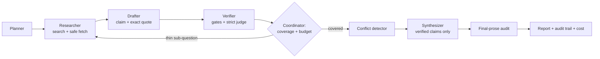

# DeepDive — a self-verifying research analyst

Multi-agent research that **checks every claim against the exact source it cites** before it reaches the report.
Unsupported claims are removed, thin areas trigger more research, and every decision is logged and costed.
All LLM calls go through **Mesh API** (`https://api.meshapi.ai/v1`, OpenAI SDK).

## Architecture



| Agent | Job | Model role (chain env var) |
|---|---|---|
| Planner | sub-questions + queries | `MODELS_PLANNER` |
| Researcher | web search + safe fetch, query refinement | `MODELS_RESEARCHER` |
| Drafter | claims with verbatim supporting quotes | `MODELS_WRITER` |
| Verifier | gates + independent judge (never sees the draft) | `MODELS_VERIFIER` (different family) |
| Conflict detector | flags disagreements, prefers higher-quality source | `MODELS_VERIFIER` |
| Synthesizer | prose from verified claim ids only | `MODELS_WRITER` |

## Why citations can be trusted
1. **Quote gate** - the quote must exist verbatim in the cited source.
2. **Number gate** - every number in the claim must appear in the source (fuzzy matching never tolerates changed digits).
3. **Strict judge** - a different model family sees only (claim, passage); invalid output = rejected (fail-closed).
4. **Structured synthesis** - sentences without valid verified claim ids are discarded in code.
5. **Final-prose audit** - the finished sentences are verified again against their sources.

## Production hardening (what is built in)
| Risk | Mitigation (file) |
|---|---|
| Model down / slow / rate-limited | timeouts, bounded retries with backoff+jitter, **ordered fallback chain per role**, **circuit breaker per model** (`llm.py`) |
| Verifier outage | **fail closed**: no unverified claim is ever published; run ends `failed_verifier_down` or publishes a **partial** report of already-verified claims (`graph.py`) |
| Non-critical agent outage | degrades gracefully: planner -> single sub-question, synthesizer/auditor -> verbatim verified claims, conflict detector skipped; every degradation is listed in the report (`graph.py`) |
| Runaway spend | per-run **cost cap, call cap, deadline**; research loops stop at 70% budget; global concurrency cap (`llm.py`, `app.py`) |
| Cost visibility | tokens + USD per call stored (`usage` table); per-run breakdown by agent and model at `/api/runs/{id}/cost`; Prometheus counters at `/metrics` |
| SSRF via fetched URLs | public-IP-only fetch, manual redirect re-validation, size cap, HTML-only (`sources.py`) |
| Prompt injection from web pages | prompts mark passages untrusted; the gates make injected claims fail anyway |
| Abuse | API key (`DEEPDIVE_API_KEY`), per-IP rate limit, input/upload validation (`app.py`) |
| Crashes | stale runs marked `interrupted` on startup; WAL SQLite + busy timeout; last-resort exception handler (`store.py`, `graph.py`) |
| Operations | `/healthz`, `/readyz` (DB, config, breaker states), JSON logs, Dockerfile (non-root, healthcheck) |

Run statuses: `done`, `partial`, `budget_exceeded`, `timeout`, `failed_verifier_down`, `failed_auth`, `error`, `interrupted`.

### Cost model
`cost = prompt_tokens x input_price + completion_tokens x output_price` per call, using the table in `config.py`
(approximate; override with `PRICES_JSON` after checking the Mesh dashboard). A typical run makes roughly 30-60 LLM
calls (plan, per-sub-question drafting and refinement, claim judging in batches of 5, conflict check, synthesis,
audit). Measure your real number with `/api/runs/{id}/cost` and the eval table; do not trust estimates.

## What a reviewer can verify in the UI (Proof tab)
| Review point | Where to see it | What it shows |
|---|---|---|
| A coordinator genuinely orchestrates distinct agents and passes results between them | **Proof -> Agents & handoffs** | 6 LLM agents + the coordinator, each with its own job, tools, model chain and a fingerprint of its own prompt; every result handed from one agent to the next, per research round, including the loop-back |
| The verifier really rejects unsupported claims | **Removed claims** | each removed claim side by side with what its source actually says, the bad number highlighted, the gate or judge that removed it, and why |
| Citations really support the sentences they are attached to | **Report** (click a sentence) and **Proof -> re-check** | the verbatim quote highlighted in the source passage; a button that re-judges every sentence with a different model chain and underlines each sentence green / amber / red |
| A visible decision trail and honest, self-measured numbers | **Live log**, **Self-evaluation**, **Files** | every event logged; this run's measured numbers; the test-set and red-team results if the harness has been run, otherwise an explicit "not measured yet" (never invented numbers); metric definitions and their limits |

New endpoints: `/api/runs/{id}/proof`, `/handoffs`, `/removed`, `POST /recheck`, and `/api/eval`.
`DEEPDIVE_EVAL_DIR` (default `eval`) is where `eval.run_eval` / `eval.redteam` write the results the UI displays.

## Failover alternatives
| What can fail | Alternative that takes over |
|---|---|
| A model or the gateway for one model | next model in that agent's chain (`MODELS_*`), with retries, backoff and a per-model circuit breaker |
| The search engine | next provider: DuckDuckGo -> Brave -> Tavily -> Wikipedia (`SEARCH_PROVIDERS`; keyed ones skipped without a key; each has its own breaker) |
| A page that blocks or is down | Internet Archive snapshot of the same URL, labelled "(archived copy)" (never used for blocked/unsafe URLs or non-HTML) |
| Planner / conflict detector / synthesizer / audit | degraded modes that stay safe (single sub-question, skipped check, verbatim verified claims) |
| The verifier | deliberately NO weaker substitute: the run stops (fail closed) |
| A stopped run (verifier outage, budget, timeout, crash) | **Resume** (`POST /api/runs/{id}/resume` or the Resume button): re-enters the graph where it stopped, reuses stored evidence and verdicts, and gets a fresh budget allowance |

## Everything generated is readable
Dashboard tabs **Report / Claims / Evidence / Follow-ups / Files**, plus a prompt-and-answer viewer on every LLM call.
Click any report sentence to see the claim, its status and the supporting quote highlighted inside the source passage.
| Endpoint | Content |
|---|---|
| `/api/runs/{id}/report.html` `.md` `.json` | the cited report (`?fragment=true` for embedding) |
| `/api/runs/{id}/claims` | every claim: verdict, deciding stage, reason, quote, source |
| `/api/runs/{id}/evidence` | every retrieved passage, quality weight, and the claims citing it |
| `/api/runs/{id}/log.txt` | readable audit log of everything the agents did |
| `/api/runs/{id}/llm/{call_id}` | exact prompt and answer of one LLM call (`STORE_LLM_IO=0` disables storing) |
| `/api/runs/{id}/followups` | follow-up questions and verified answers |
| `/api/runs/{id}/cost` | tokens and cost by agent and model |
| `/api/runs/{id}/bundle.zip` | all of the above in one download |

## Latency and scaling
- **Parallel stages:** research, drafting, claim judging and conflict checks run across sub-questions in parallel
  (`PARALLEL_WORKERS`), with a process-wide cap on in-flight model requests (`MAX_INFLIGHT_LLM`) so parallelism does not
  provoke rate limits. Results, call counts and cost are identical to sequential mode (tested).
- **Simulated benchmark** (5 sub-questions, 100 ms per model call; NOT real Mesh latency): 3.29 s sequential -> 1.30 s
  with 5 workers. Measure your real numbers: `python -m eval.latency_report <run_id>`.
- **Also:** page cache, bounded downloads, per-step timings and LLM latency percentiles (`/api/runs/{id}/cost`), partial
  results on timeout/budget stop, and a resume path.
- **Capacity and scale-out plan** (Postgres, queue + workers, Redis for limits/breakers/cache): [`docs/SCALING.md`](docs/SCALING.md).

## Hyperparameters
Every tunable value has an inline decision record in `deepdive/config.py` and a table in
[`docs/HYPERPARAMETERS.md`](docs/HYPERPARAMETERS.md) (why, risk if too low/high, which metric to tune with).
They are reasoned defaults that have not yet been tuned on data; the doc says how to do that.

## Run it
```bash
python -m venv .venv && source .venv/bin/activate
pip install -r requirements.txt
cp .env.example .env            # add MESH_API_KEY; confirm model ids in the Mesh dashboard
python -m deepdive.doctor       # tests config + every model in every chain
uvicorn app:app --reload        # http://localhost:8000
pytest -q tests                 # 67 offline tests (fake LLM + fake web, no key needed)
docker build -t deepdive . && docker run -p 8000:8000 --env-file .env -v dd:/data deepdive
```

## Live dashboard (http://localhost:8000)
One screen shows what the system is doing right now:
- **Running now** banner with the active agent and its current action; spinner while work is in flight.
- **Pipeline**: every agent step with a state (pending, running, done, degraded, failed, skipped, interrupted),
  loop count (x2 = researched again), time spent and its latest action; totals for completed / ongoing / failed.
- **Live log** (filter by level, agent or text; autoscroll; download as JSON). Rejected claims are shown as their own
  level because rejection is an expected outcome of verification, not a failure.
- **Counters**: verified / flagged / rejected / pending claims, sources, passages, LLM calls (failed, fallbacks), tokens, cost.
- **LLM call feed** and **circuit-breaker states**, an **Issues** panel, and a **Runs** list (completed, ongoing, failed).
Backed by `GET /api/runs/{id}/live?since=N` (snapshot + only the new log lines) and `GET /api/runs`; see `deepdive/live.py`.

## Self-evaluation
```bash
python -m eval.run_eval          # 10 questions -> eval/RESULTS.md (groundedness, coverage, cost)
python -m eval.redteam <run_id>  # corrupts verified claims, measures the verifier's catch rate -> eval/REDTEAM.md
```
### Results
_Paste the tables from `eval/RESULTS.md` and `eval/REDTEAM.md` here after running (numbers must come from your own run)._

## Honest limits (not production-complete)
- SQLite + background threads: one instance only. Multi-instance needs Postgres and a job queue (Celery/RQ).
- DuckDuckGo search and HTML-only fetch: no PDFs or JavaScript-rendered pages. A real search API is the best upgrade.
- LLM verification reduces but cannot eliminate errors; the red-team table shows where it is weakest.
- Stored prompts contain fetched web text and the user's question: set `STORE_LLM_IO=0` for sensitive data; there is no per-run delete/retention job yet.
- Archive snapshots can differ from the live page; evidence from them is labelled but not down-weighted.
- The SSRF check validates DNS before connecting; a DNS-rebinding race is possible (pin the resolved IP to close it).
- In-memory rate limiting and breakers are per process.
- Prices in `config.py` are approximations.
